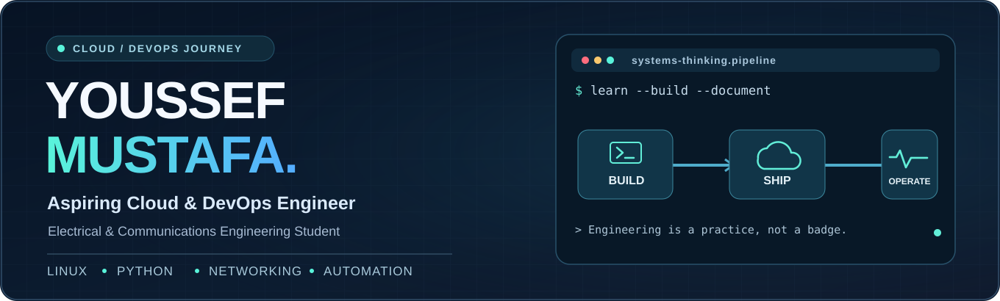
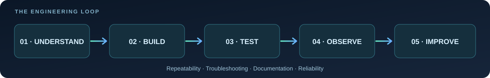

  

  <a href="https://youssefmu.vercel.app/"><strong>Portfolio</strong></a>
  &nbsp; • &nbsp;
  <a href="https://www.linkedin.com/in/youssef-mustafa-031279280/"><strong>LinkedIn</strong></a>
  &nbsp; • &nbsp;
  <a href="mailto:yousefmustafa446@gmail.com"><strong>Email</strong></a>
  &nbsp; • &nbsp;
  <a href="https://github.com/YousefMO17?tab=repositories"><strong>All projects</strong></a>

---

### Hey, I'm Youssef 👋

I'm an **Electrical & Communications Engineering student** working toward a career in **Cloud & DevOps Engineering**, with a long-term interest in **Platform Engineering and Site Reliability Engineering (SRE)**.

My starting point is **Linux, networking, Python and practical troubleshooting**. I learn best by turning concepts into small reproducible labs, documenting what works, and understanding *why* it works.

> **My goal:** grow from understanding individual tools to building reliable, observable and repeatable systems.

### ⚙️ Technical focus

| Foundations I've studied / practiced | Currently learning | On the roadmap |
|:--|:--|:--|
| Linux administration · networking fundamentals · Python · Git & GitHub | Docker & containerization · AWS cloud fundamentals · automation labs | Terraform · CI/CD · Kubernetes · monitoring & observability |

**Note:** These are deliberately separated by learning stage. A tool listed here is not a claim of production experience or certification.

### 🧩 Selected work

| Project | What you'll find |
|:--|:--|
| **[Cloud & DevOps Learning Labs](https://github.com/YousefMO17/Cloud_DevOps_Learning)** | My evolving hands-on notebook for Python, Linux and cloud fundamentals. Labs, experiments and learning notes — organized as I grow. |
| **[Telecom KPI Watchdog](https://github.com/YousefMO17/telecom-kpi-watchdog)** | An early-stage Python monitoring experiment with sample KPI data and a Dockerfile — connecting my telecom background to automation. |
| **[5G Honeypot & TCP Tarpit](https://github.com/YousefMO17/5G-Honeypot-Tarpit)** | A controlled security lab exploring TCP socket behavior, honeypot concepts and Docker packaging. **For educational, authorized environments only.** |
| **[Menawar Monitor · IoT Solar Tracker](https://github.com/YousefMO17/Menawar-Monitor)** | A dual-axis solar-tracking and telemetry project, including IoT dashboard simulation. Hardware integration is a separate project stage. |

### 🛠️ The way I learn to engineer

  

Instead of collecting technologies, I focus on **repeatable labs**, **clear READMEs**, **testing assumptions**, and **writing down the failure and the fix**. That's the mindset I'm developing for Cloud/DevOps.

### 🚀 What's next

- **Now:** strengthen Linux, Python automation and Docker fundamentals through hands-on labs.
- **Next:** build and document a containerized application with useful logging, tests and a simple deployment workflow.
- **Later:** introduce cloud deployment, Infrastructure as Code, CI/CD and observability as my projects become ready for them.

<strong>📚 Learning philosophy</strong>

 

I treat this GitHub as a **public engineering notebook**. Some repositories are prototypes or learning exercises — I'll keep their documentation honest about what is implemented, simulated, tested or planned.

When I finish a project, I want someone else to be able to answer: **What problem does it solve? How does it work? How can I run it? How do I know it works?**

---

  <strong>Let's connect and build useful systems.</strong> 
  <a href="https://www.linkedin.com/in/youssef-mustafa-031279280/">LinkedIn</a> ·
  <a href="https://youssefmu.vercel.app/">Portfolio</a> ·
  <a href="mailto:yousefmustafa446@gmail.com">Email</a>

